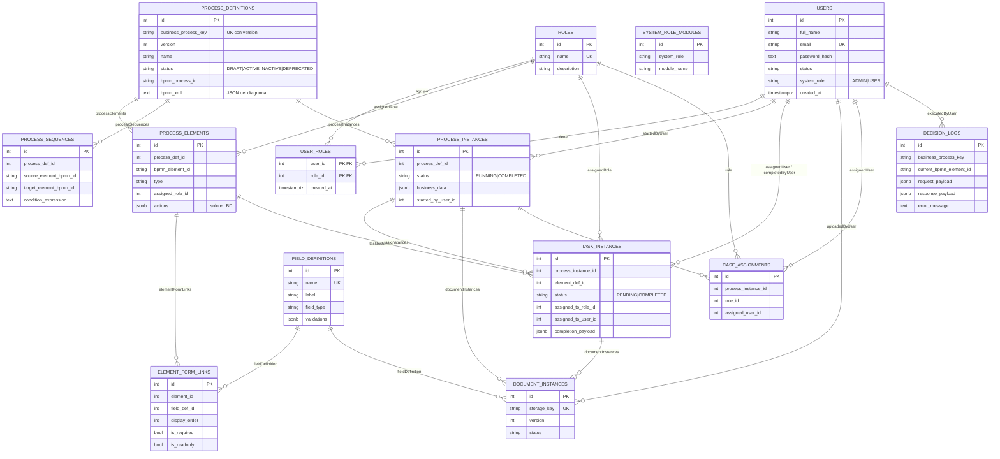
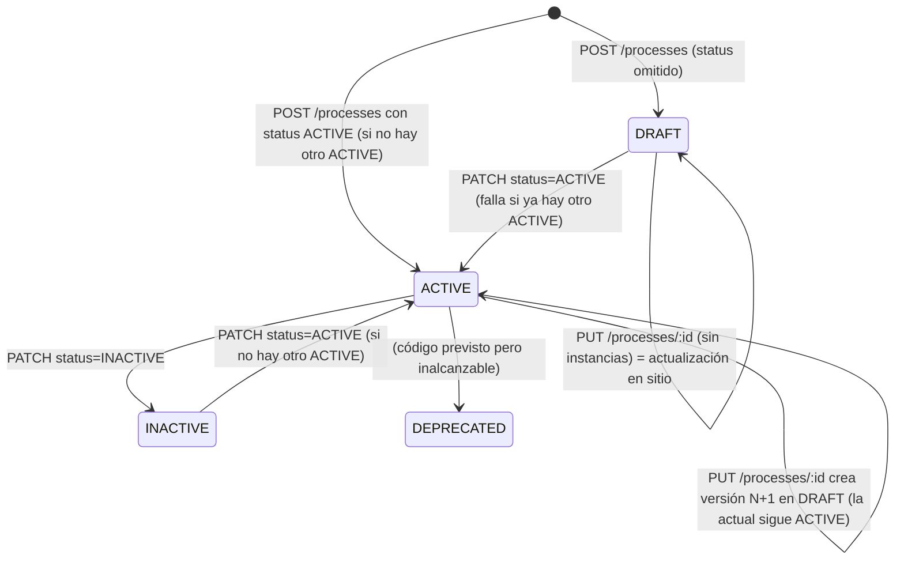

# Flowify BPMS — Blueprint funcional y de negocio del backend

> Repositorio: `my-bpm-back-express` · Fecha de levantamiento: 2026-11-05 · Último commit analizado: `95e97c4`
> Alcance: todo lo implementado en `src/`, el esquema real de la base Postgres (introspección de solo lectura),
> la documentación existente (`README.md`, `GEMINI.md`, `.idx/airules.md`) y `resources/`.
> **Actualización tras la migración a TypeScript (Spec Kit feature 001, rama `001-typescript-migration`, T093 / FR-041).**
> Hoy el código fuente de verdad es `src/**/*.ts`. Las referencias `ruta:línea` a archivos `.js` que quedan en
> este documento (§1, §4, §5, §10, §11 y el resto) corresponden al commit `95e97c4` (pre-migración) y se
> conservan como evidencia histórica; las del **motor** (§6 y §7) ya apuntan a los `.ts`. Donde un hallazgo
> original quedó corregido, §11 lo marca con "Resuelto en 001".
> Las normas de ingeniería derivadas de este documento están en `.specify/memory/constitution.md`.

> **Fase del proyecto: construcción y piloto / demo.** Flowify todavía no tiene ambientes de QA ni de
> producción, y no los tendrá hasta estar lo suficientemente armado para entrar en la dinámica de producto
> oficial. La base remota contiene datos de demo. Por eso, las brechas de seguridad, los datos de demo y la
> falta de pruebas descritas en §11 son **conocidas y aceptadas en esta fase**: se documentan para no
> perderlas de vista y deben resolverse antes del primer ambiente de QA o producción. Las prioridades
> C/A de §11.1 miden el riesgo para ese momento, no un bloqueo actual. Qué reglas se relajan y cuáles son
> los criterios de salida está en la sección "Fase del proyecto" de la constitution.

---

## Índice

1. [Propósito del producto](#1-propósito-del-producto)
2. [Glosario de dominio](#2-glosario-de-dominio)
3. [Arquitectura en una página](#3-arquitectura-en-una-página)
4. [Modelo de datos real](#4-modelo-de-datos-real)
5. [Ciclo de vida de una definición de proceso](#5-ciclo-de-vida-de-una-definición-de-proceso)
6. [Ciclo de vida de instancias y tareas (motor)](#6-ciclo-de-vida-de-instancias-y-tareas-motor)
7. [Motor de decisiones como servicio](#7-motor-de-decisiones-como-servicio)
8. [Autenticación y autorización](#8-autenticación-y-autorización)
9. [Catálogo completo de endpoints](#9-catálogo-completo-de-endpoints)
10. [Reglas de negocio y validaciones explícitas](#10-reglas-de-negocio-y-validaciones-explícitas)
11. [Brechas, inconsistencias y deuda técnica](#11-brechas-inconsistencias-y-deuda-técnica)
12. [Cómo levantar en local](#12-cómo-levantar-en-local)
13. [Evolución del código (historial git)](#13-evolución-del-código-historial-git)
14. [Pendientes de confirmar](#14-pendientes-de-confirmar)

---

## 1. Propósito del producto

**Flowify BPMS** es un sistema de gestión de procesos de negocio (BPM) compuesto por:

- **Este backend** (Node 20 + TypeScript + Express 4 + Sequelize 6 + PostgreSQL): API REST que almacena las
  definiciones de proceso modeladas, ejecuta un **motor de procesos propio** basado en un grafo de
  elementos y secuencias, gestiona la bandeja de tareas de los usuarios, y expone la lógica de
  decisión del grafo como servicio ("Business Logic as a Service").
- **El frontend** `sveltekit-bpm` (repositorio hermano): modelador visual (SvelteFlow), bandeja de
  tareas, consola de administración. Consume `http://localhost:3000/api`.

Capacidades de negocio implementadas hoy:

| Capacidad | Estado | Dónde |
|---|---|---|
| Login con JWT y menú por módulos según `systemRole` | Implementado | `src/api/auth/` |
| Edición de perfil propio y cambio de contraseña | Implementado | `src/api/auth/auth.service.js:42` |
| Administración de usuarios (multi-rol) | Implementado (solo ADMIN) | `src/api/users/` |
| Administración de roles de proceso y sus miembros | Implementado (solo ADMIN) | `src/api/roles/` |
| Modelado y guardado de procesos con versionado automático | Implementado | `src/api/processes/process.service.js:94` |
| Ciclo de vida DRAFT / ACTIVE / INACTIVE / DEPRECATED | Parcial (ver §5) | `process.service.js:205` |
| Formulario de inicio de un proceso | Implementado (lectura) | `process.service.js:320` |
| Inicio de instancias y avance automático por el grafo | Implementado | `src/api/engine/execution.service.ts` |
| Gateways exclusivos con condiciones (expr-eval) | Implementado | `execution.service.ts:95`, `context.ts:180` |
| Gateways paralelos (fork y join) | Implementado con limitaciones | `execution.service.ts:75`, `:253` |
| Bandeja "Mis tareas" por usuario o rol | Implementado | `src/api/tasks/task.service.js:16` |
| Formulario de tarea con datos de la instancia | Implementado | `task.service.js:66` |
| Completar tarea (acción + datos + comentarios) | Implementado | `execution.service.ts:170` |
| Decisión de siguiente tarea sin instancia + auditoría | Implementado | `src/api/engine/decision.service.ts:101` |
| Biblioteca de campos (field definitions) vía API | **No implementado** (solo modelo) | `src/models/field-definition.model.js` |
| Diseño de formularios (element form links) vía API | **No implementado** | — |
| Documentos adjuntos (S3) | **No implementado** (solo modelo/tabla vacía) | `src/models/document-instance.model.js` |
| Case assignments (usuario fijo por rol y caso) | **No implementado** (solo modelo/tabla vacía) | `src/models/case-assignment.model.js` |
| SLA / fechas de vencimiento | **No implementado** (campos sin uso) | `process_elements.sla_definition`, `task_instances.due_date` |
| Tareas automáticas / webhooks (n8n) | **No implementado** en el motor | `process_elements.webhook_target` |

---

## 2. Glosario de dominio

| Término | Definición en este sistema |
|---|---|
| **Definición de proceso** (`ProcessDefinition`, tabla `process_definitions`) | Una **versión concreta** de un proceso de negocio: metadatos (nombre, categoría, estado), el JSON del diagrama y su grafo (elementos + secuencias). Cada fila es una versión. |
| **businessProcessKey** | Identificador de negocio estable que agrupa todas las versiones de un mismo proceso (p. ej. `PURCHASE_REQUEST`). Único junto con `version` (`process-definition.model.js:54-59`). Es la clave con la que se **inicia** un proceso y se consulta el motor de decisiones. |
| **Versión** (`version`) | Entero incremental por `businessProcessKey`. La v1 se crea en el primer guardado; las siguientes las crea el versionado automático (§5). |
| **bpmnProcessId** | ID técnico del proceso en el diagrama (obligatorio, `process-definition.model.js:36`). Hoy no tiene uso funcional en el backend. |
| **diagramJson / bpmnXml** | JSON opaco del modelador (nodos/aristas de SvelteFlow). Se guarda serializado en la columna `bpmn_xml` (nombre heredado; **no** contiene XML BPMN) y se devuelve como `diagramJson` (`process.service.js:118`, `:176`, `:294-299`). |
| **Elemento** (`ProcessElement`, `process_elements`) | Nodo del grafo: `START_EVENT`, `USER_TASK`, `EXCLUSIVE_GATEWAY`, `PARALLEL_GATEWAY`, `END_EVENT`, `AUTO_TASK` (este último existe en datos y en el decision service, pero el motor de ejecución no lo soporta). Se identifica en el grafo por `bpmnElementId` (string) y en la base por `id`. Puede tener `assignedRoleId` (rol responsable). |
| **Secuencia** (`ProcessSequence`, `process_sequences`) | Arista dirigida `sourceElementBpmnId → targetElementBpmnId` dentro de una definición, con `conditionExpression` opcional (usada solo por gateways exclusivos). Referencia a elementos por **bpmnElementId**, no por id numérico. |
| **Gateway exclusivo** | Elige **un único** camino: la primera secuencia saliente cuya condición evalúe `true`; si ninguna, la secuencia sin condición (por defecto); si no hay, error. |
| **Gateway paralelo** | Como *fork* sigue todas las salidas; como *join* espera a que estén completadas las tareas de todas las entradas (solo detectado al completar una tarea, ver §6.4). |
| **Instancia de proceso** (`ProcessInstance`, `process_instances`) | Una ejecución ("caso") de una versión concreta. Guarda `businessData` (JSONB acumulado), `description`, `status` (`RUNNING`, `COMPLETED`), quién la inició y tiempos. |
| **Tarea** (`TaskInstance`, `task_instances`) | Trabajo humano pendiente generado al llegar a un `USER_TASK`. Estados `PENDING` → `COMPLETED`. Se asigna a un rol (`assignedToRoleId`) y opcionalmente a un usuario (`assignedToUserId`, hoy nunca lo llena el motor). Guarda `completionPayload` y `comments`. |
| **Case assignment** (`CaseAssignment`, `case_assignments`) | Diseño previsto: fijar qué usuario concreto asume un rol en un caso (único por instancia+rol). **Sin lógica ni endpoints**; tabla vacía. |
| **Documento** (`DocumentInstance`, `document_instances`) | Diseño previsto: metadatos de archivos subidos (clave en S3, versión, estado ACTIVE/SUPERSEDED/DELETED según el SQL legado). **Sin lógica ni endpoints**; tabla vacía. |
| **Field definition** (`FieldDefinition`, `field_definitions`) | Biblioteca global y reutilizable de campos de formulario: `name` técnico único (es la clave dentro de `businessData`), `label`, `fieldType` (`TEXT`, `NUMBER`, `SELECT`, `GRID`, `DATE` en datos) y `validations` JSONB (p. ej. `options` para SELECT, `columns`/`dataSource` para GRID). |
| **Element form link** (`ElementFormLink`, `element_form_links`) | Ensambla el formulario de un elemento: qué campos muestra, `displayOrder`, `isRequired`, `isReadonly`, `contextualValidations`. |
| **Decision log** (`DecisionLog`, `decision_logs`) | Auditoría de cada llamada a `POST /api/engine/decide-next-task`: request, response o error, usuario y fecha. |
| **systemRole** | Rol **de plataforma** del usuario, columna `users.system_role` con CHECK `ADMIN`/`USER` en la base. Controla acceso a endpoints administrativos (`isAdmin`) y los módulos de UI. |
| **Roles de proceso** (`Role`, `roles` + `user_roles`) | Roles **de negocio** (p. ej. "Manager", "Revisor Financiero") a los que se asignan tareas. Relación N:M con usuarios. Viajan en el JWT como `roleIds`. |
| **Módulos** (`SystemRoleModule`, `system_role_modules`) | Códigos de menú del frontend habilitados por `systemRole`. Datos actuales: **ADMIN** → `DASH, TASK, INST, PROC, ORG, LOG, LIBFORM`; **USER** → `DASH, TASK, INST`. Se devuelven en el login; **el backend no los usa para autorizar**. |
| **Formulario de inicio** | Campos enlazados al `START_EVENT` de la definición (`GET /api/processes/:id/start-form`). |
| **Contexto de evaluación** | Objeto contra el que se evalúan condiciones: `businessData` aplanado en la raíz + `instance` (datos de la instancia sin `businessData`) + `task` (acción, formData, comentarios, quién completó). |

Interpretación probable de los códigos de módulo (no hay tabla de descripciones; **Pendiente de confirmar** con el frontend):
`DASH` tablero, `TASK` mis tareas, `INST` instancias, `PROC` modelador de procesos, `ORG` usuarios y roles,
`LOG` logs de decisión, `LIBFORM` biblioteca de formularios/campos.

---

## 3. Arquitectura en una página

El backend está escrito en **TypeScript** (modo `strict`, `module: node16`), se compila a CommonJS en `dist/`
(misma profundidad que `src/`) y en desarrollo se ejecuta con `tsx`. Las dependencias entre capas van de
arriba abajo: rutas → controller → servicio → modelos; `src/domain` no depende de nada.

```
src/server.ts                   ← arranque: valida config, sequelize.authenticate(), app.listen (único lugar que escucha)
src/app.ts                      ← construye y exporta la app Express (helmet, cors, rate limit, passport, /api, error middleware); sin listen, importable por pruebas
src/api/routes.ts               ← monta /roles /users /auth /tasks /processes /process-instances /engine /fields /formdata-elements
src/api/<modulo>/
    <x>.routes.ts               ← rutas + middlewares protect / isAdmin / idParam / validateBody
    <x>.schemas.ts              ← esquemas zod de entrada (solo rechazan lo que antes ya fallaba)
    <x>.controller.ts           ← lee req, llama al servicio, responde (catchAsync; sin try/catch)
    <x>.service.ts              ← lógica de negocio + acceso a datos con modelos Sequelize; lanza AppError
    <x>.mappers.ts              ← modelo Sequelize → DTO de respuesta (la forma HTTP queda congelada)
src/api/engine/                 ← motor, dividido en núcleo puro y cáscaras:
    graph.ts, context.ts,         NÚCLEO PURO (sin models ni sequelize): grafo, contexto de evaluación,
    semantics.ts, traversal.ts      semántica por tipo de nodo (NODE_SEMANTICS), ruta exclusiva, detección de ciclos
    execution.service.ts          CÁSCARA de ejecución: transacción + efectos en BD (startProcess, completeTask)
    decision.service.ts           CÁSCARA de decisión: simulación sin estado + decision logs
src/domain/                     ← constants.ts (ElementType...), types.ts (BusinessData, AuthUser...), errors.ts (AppError + fábricas)
src/api/middlewares/            ← auth (passport-jwt), admin (systemRole), validate (validateBody, idParam, parseIntIdParam), error (formateador único)
src/models/*.model.ts           ← un modelo por tabla; asociaciones centralizadas en models/index.ts
src/config/                     ← env.ts (dotenv), index.ts (config tipada, inmutable y validada), environment.ts, database.ts, passport.ts, JSON de `config`
src/utils/                      ← catchAsync, expressionEngine (expr-eval), logger (winston único), pick, formFields
src/types/                      ← declaraciones (`express.d.ts` para `req.user`, `expr-eval.d.ts`)
public/index.html               ← página estática "El servidor funciona"
tests/                          ← jest: contract (supertest), engine, unit, fixtures, setup (Postgres de pruebas)
```

Flujo de una petición: `app.ts` → `express.json` → `helmet` → `cors` → `static(public)` → rate limit
(100 req / 15 min por IP) → `passport.initialize` → router `/api` → `protect` (passport-jwt) → `isAdmin`
(opcional) → `idParam` / `validateBody` (opcionales) → controller → service → modelos → Postgres → `errorMiddleware`.

**Motor: núcleo puro vs. cáscaras.** El núcleo (`graph`, `context`, `semantics`, `traversal`) solo recibe y
devuelve datos planos: construye el grafo, arma el contexto de evaluación, elige la ruta exclusiva y detecta
ciclos. Las cáscaras (`execution.service`, `decision.service`) cargan el grafo, aplican la semántica y, solo en
ejecución, escriben en la base. `NODE_SEMANTICS` usa `satisfies Record<ElementType, NodeSemantics>`: agregar un
tipo de elemento sin definir su comportamiento impide compilar.

**Errores.** Los servicios lanzan `AppError` (fábricas `notFound`, `conflict`, `modelError`, `validation`...);
`error.middleware.ts` es el único formateador (§9).

**Arranque.** `server.ts` importa primero `config/env` (dotenv y `NODE_CONFIG_DIR`), luego carga `config/index.ts`,
que valida las variables obligatorias; si falta alguna el proceso termina con código 1. Después ejecuta
`sequelize.authenticate()` y solo entonces escucha. No hay `sequelize.sync()`: **el esquema no lo crea la app**,
existe previamente en la base.

---

## 4. Modelo de datos real

### 4.1 Fuente de verdad

- El **esquema vigente** es el de la base Postgres remota, que coincide con los modelos Sequelize de
  `src/models/` salvo las diferencias marcadas abajo.
- `resources/SQL Create flowifybpm test.sql` está **obsoleto**: error de sintaxis (falta coma en
  `roles.name`, línea 20), usa `users.role_id` (línea 32) en vez de la tabla `user_roles`, no tiene
  `users.system_role`, `decision_logs`, `system_role_modules`, `process_instances.description`,
  `task_instances.comments`, `process_elements.actions`/`case_assignment_config`.
- `resources/old-prisma-scheme.prisma` es legado del ORM anterior (Prisma, con `relationMode = "prisma"`),
  reemplazado por Sequelize en el commit `37b3687`.

### 4.2 Hallazgo crítico: la base NO tiene claves foráneas de dominio

La introspección (`pg_constraint`) muestra que las **únicas** restricciones de integridad referencial son:

| Tabla | Restricción |
|---|---|
| `user_roles.user_id` | FK → `users(id)` ON DELETE CASCADE |
| `user_roles.role_id` | FK → `roles(id)` ON DELETE CASCADE |
| `decision_logs.executed_by_user_id` | FK → `users(id)` ON DELETE SET NULL (¡pero la columna es NOT NULL!) |
| `users.system_role` | CHECK IN (`ADMIN`, `USER`) |

Todas las demás relaciones (definición→elementos, instancia→tareas, etc.) son **solo lógicas**,
declaradas en `src/models/index.js`. Los `onDelete: 'CASCADE'` de `models/index.js:18-34` **no tienen
efecto** en runtime: Sequelize solo los aplicaría al crear tablas con `sync()` (no se usa) o con
`hooks: true` en borrados de instancia (no se usa). Consecuencia comprobada: existen **3 tareas
huérfanas** cuya instancia fue borrada y **3 tareas** cuyo elemento de definición ya no existe.
(Herencia probable del `relationMode = "prisma"`.)

### 4.3 Entidades

Convención: atributo Sequelize en camelCase → columna snake_case vía `field`. Todas usan
`timestamps: false` salvo `user_roles` (`created_at` gestionado por Sequelize).

**Seguridad y organización**

| Tabla | Campos clave | Notas |
|---|---|---|
| `users` | `id`, `full_name`, `email` (UNIQUE), `password_hash` (bcrypt), `status` (def. `ACTIVE`), `system_role` (def. `USER`, CHECK ADMIN/USER), `created_at` | `status` no se verifica en login (§11). |
| `roles` | `id`, `name` (UNIQUE), `description` (NOT NULL) | Roles de proceso. |
| `user_roles` | PK (`user_id`,`role_id`), `created_at` | N:M usuarios-roles, FKs reales con CASCADE. |
| `system_role_modules` | `id`, `system_role`, `module_name`, UNIQUE(`system_role`,`module_name`) | Sin asociaciones; se consulta por `systemRole` en login. |

**Definición (diseño de procesos)**

| Tabla | Campos clave | Notas |
|---|---|---|
| `process_definitions` | `id`, `business_process_key`, `name`, `description`, `version`, `category`, `status` (def. `DRAFT`), `bpmn_process_id` (NOT NULL), `bpmn_xml` (JSON del diagrama), `created_at`; UNIQUE(`business_process_key`,`version`) | Estados en datos: `ACTIVE`, `INACTIVE`. |
| `process_elements` | `id`, `process_def_id`, `bpmn_element_id`, `name`, `description`, `type`, `assigned_role_id`, `webhook_target`, `sla_definition` JSONB, **`actions` JSONB**, **`case_assignment_config` JSONB** | `actions` y `case_assignment_config` existen en la base pero **no en el modelo** (§11). `actions` tiene datos (p. ej. `["Aprobar","Rechazar"]`). |
| `process_sequences` | `id`, `process_def_id`, `source_element_bpmn_id`, `target_element_bpmn_id`, `condition_expression` | Referencias por bpmnElementId (strings). |
| `field_definitions` | `id`, `name` (UNIQUE), `label`, `field_type`, `validations` JSONB | Biblioteca global. |
| `element_form_links` | `id`, `element_id`, `field_def_id`, `display_order`, `is_required`, `is_readonly`, `contextual_validations` JSONB | 50 filas; no hay API para gestionarlas. |

**Ejecución**

| Tabla | Campos clave | Notas |
|---|---|---|
| `process_instances` | `id`, `process_def_id`, `description`, `status` (`RUNNING`/`COMPLETED`), `business_data` JSONB, `started_by_user_id`, `start_time`, `end_time`; índice por `status` | |
| `task_instances` | `id`, `process_instance_id`, `element_def_id`, `status` (`PENDING`/`COMPLETED`), `comments`, `assigned_to_role_id`, `assigned_to_user_id`, `due_date`, `created_at`, `completed_by_user_id`, `completion_time`, `completion_payload` JSONB; índices por `status`, rol, usuario | `completion_payload` guarda `{action, formData, comments}`. |
| `document_instances` | `id`, `process_instance_id`, `task_instance_id`, `field_def_id`, `storage_key` (UNIQUE), `file_name`, `version`, `status`, `uploaded_by_user_id`, `created_at` | Vacía, sin uso. |
| `case_assignments` | `id`, `process_instance_id`, `role_id`, `assigned_user_id`; UNIQUE(`process_instance_id`,`role_id`) | Vacía, sin uso. |
| `decision_logs` | `id`, `business_process_key`, `current_bpmn_element_id`, `request_payload` JSONB, `response_payload` JSONB, `error_message`, `executed_by_user_id`, `created_at`; índices por key, elemento, usuario | |

### 4.4 Diagrama ER (relaciones lógicas de `models/index.js`)

Las líneas representan asociaciones Sequelize. Solo `USER_ROLES` tiene FKs físicas.



### 4.5 Cascadas: lo declarado vs. lo que realmente ocurre

| Operación | Declarado en modelos | Lo que realmente pasa |
|---|---|---|
| Borrar definición (`DELETE /processes/:id`) | CASCADE a elementos y secuencias | El servicio borra explícitamente secuencias y elementos (`process.service.js:312-314`). **No** borra `element_form_links` de esos elementos ni verifica instancias: quedan instancias/tareas apuntando a una definición inexistente. |
| Borrar instancia (`DELETE /process-instances/:id`) | CASCADE a tareas, documentos, case assignments | `ProcessInstance.destroy({where})` (`processInstance.service.js:133-135`) **no** cascada: tareas huérfanas (ya hay 3 en la base). |
| Borrar elemento en sincronización DRAFT | CASCADE a form links | `ProcessElement.destroy({where:{id}})` (`process.service.js:59`) deja form links y tareas huérfanas. |
| Borrar usuario | — | `user_roles` cascada (FK real). Si el usuario tiene `decision_logs`, la FK `SET NULL` choca con `NOT NULL` → error 500. Instancias/tareas que lo referencian quedan huérfanas. |
| Borrar rol | — | Bloqueado si tiene usuarios (409, `role.service.js:53-58`). No verifica elementos/tareas que lo referencian. |

---

## 5. Ciclo de vida de una definición de proceso

### 5.1 Estados

| Estado | Significado | Cómo se llega hoy |
|---|---|---|
| `DRAFT` | En diseño, editable en sitio. | Por defecto al crear (`process.service.js:191`) y toda versión nueva automática (`:117`). |
| `ACTIVE` | Versión ejecutable. **Solo una por `businessProcessKey`.** | Al crear/guardar con `status: 'ACTIVE'` (valida unicidad, `:179-182`) o por `PATCH` (`:214-215`). |
| `INACTIVE` | Archivado/deshabilitado manualmente. | `PATCH` con `status: 'INACTIVE'`. Desde 001 el `status` del PATCH se valida contra `DRAFT\|ACTIVE\|INACTIVE\|DEPRECATED` (400 `VALIDATION_ERROR` si no). Presente en datos. |
| `DEPRECATED` | Reemplazado por una versión más nueva. | Solo en código inalcanzable (§5.4). No existe en datos. |



### 5.2 Guardado unificado (`POST /api/processes`, `PUT /api/processes/:id`)

Ambos verbos llaman a `saveProcessDefinition(id, body)` (`process.service.js:94-203`), todo dentro de una
transacción Sequelize. Payload:

```json
{
  "businessProcessKey": "PURCHASE_REQUEST",
  "name": "Solicitud de compra",
  "description": "...",
  "category": "Finanzas",
  "status": "DRAFT",
  "bpmnProcessId": "Process_PURCHASE_REQUEST",
  "diagramJson": { "nodes": [], "edges": [] },
  "elements": [
    { "bpmnElementId": "start_1", "name": "Inicio", "type": "START_EVENT", "assignedRoleId": null }
  ],
  "sequences": [
    { "sourceElementBpmnId": "start_1", "targetElementBpmnId": "task_1", "conditionExpression": null }
  ]
}
```

Algoritmo:

1. Si hay `id`, carga la definición y cuenta sus instancias (`:98-105`).
2. **Debe versionar** si la definición está `ACTIVE` **o** tiene al menos una instancia (`:107-109`).
3. **Rama nueva versión** (`:112-170`):
   - Crea definición con los metadatos del body, el **mismo** `businessProcessKey`, `version = versionEditada + 1`,
     `status = 'DRAFT'` (el `status` del body se ignora) y `bpmnXml = JSON.stringify(diagramJson)`.
   - Crea todos los elementos y secuencias del body en la nueva versión.
   - **Copia los form links** de la versión anterior a la nueva, emparejando elementos por `bpmnElementId` (`:132-168`).
   - La versión anterior **no se toca** (sigue `ACTIVE` si lo estaba). Esto contradice `README.md:26`, que dice que se marca `DEPRECATED`.
   - Desde 001 (FR-028) la versión nueva es `MAX(version) de la key + 1`, calculado dentro de la transacción, aunque se edite una versión que no es la última.
4. **Rama actualización en sitio / creación** (`:172-201`):
   - Si el body trae `status: 'ACTIVE'`, valida que no exista otra versión ACTIVE para la key (`validateSingleActiveVersion`, `:18-32`); si existe, responde 409 `ACTIVE_VERSION_CONFLICT` (antes 500).
   - Si existe la definición: `update` con la lista blanca de escritura (FR-029: se ignoran `id`, `version` y `createdAt` del body; en elementos y secuencias, `id` y `processDefId`). Si no: crea con `version: 1`. Un `PUT /processes/:id` con id inexistente responde 404 (antes creaba una definición).
   - `syncElements` (`:34-61`): diff por `bpmnElementId` — actualiza existentes, crea nuevos, borra los ausentes.
   - `syncSequences` (`:63-69`): borra todas las secuencias y las recrea.
5. Responde `201` si no había `id`, `200` si lo había (`process.controller.js:13`).

### 5.3 Análisis previo al guardado (`GET /api/processes/:id/save-ask`)

`getSaveAnalysis` (`process.service.js:71-92`) permite a la UI advertir al usuario antes de guardar:
`{ state, instancesCount, action: 'UPDATE_IN_PLACE' | 'CREATE_NEW_VERSION' }` con la misma regla del punto 2.

### 5.4 Cambio de metadatos y estado (`PATCH /api/processes/:id`)

`updateProcessDefinitionMetadata` (`process.service.js:205-254`): lista blanca `name`, `description`,
`category`, `status`. Si se pasa a `ACTIVE` desde otro estado:

- Primero llama `validateSingleActiveVersion` (`:215`), que **lanza error si ya existe otra ACTIVE**.
- Después intenta pasar la ACTIVE actual a `DEPRECATED` (`:217-228`), pero ese bloque es **inalcanzable**:
  si existiera otra ACTIVE, la validación anterior ya habría lanzado. **Regla efectiva hoy**: para activar
  una versión nueva, primero hay que desactivar (PATCH a `INACTIVE`) la ACTIVE vigente.

### 5.5 Reglas de versionado (resumen)

| Regla | Fuente |
|---|---|
| (`businessProcessKey`, `version`) es único. | Índice único en BD y `process-definition.model.js:54-59` |
| Una definición ACTIVE o con instancias no se modifica en sitio: se crea versión N+1 en DRAFT. | `process.service.js:107-119` |
| La nueva versión hereda los formularios (form links) por `bpmnElementId`. | `process.service.js:132-168` |
| Solo una versión ACTIVE por key (validación de aplicación, no de BD). | `process.service.js:18-32`, `:179-182`, `:214-215` |
| Las instancias en curso siguen ligadas a su versión (`process_def_id`). | `processEngine.service.js:154-163` |
| Para iniciar instancias o decidir, se usa la ACTIVE de mayor versión. | `processEngine.service.js:145-149`, `decision.service.js:99-102` |
| ~~Riesgo: N+1 se calculaba desde la versión editada.~~ **Resuelto en 001** (FR-028): la versión nueva es `max + 1`. | `process.service.ts:210-219` |

### 5.6 Lectura

- `GET /api/processes`: solo `ACTIVE`, sin `bpmnXml`, orden `createdAt desc` (`process.service.js:256-266`). Para todos los usuarios.
- `GET /api/processes/all`: todas, solo ADMIN (`:268-275`).
- `GET /api/processes/:id`: cualquier estado; devuelve `elements`, `sequences` y `diagramJson` parseado (`:277-302`).
- `GET /api/processes/:id/start-form`: campos del `START_EVENT` ordenados por `displayOrder`, `actions: ['start']` (`:320-367`).

---

## 6. Ciclo de vida de instancias y tareas (motor)

Implementado en `src/api/engine/execution.service.ts` (cáscara) sobre el núcleo puro `graph.ts`, `context.ts`,
`semantics.ts` y `traversal.ts`. Es un **intérprete recursivo de grafo** que corre dentro de **una transacción
por operación** (iniciar proceso o completar tarea): si cualquier paso falla (incluidos los errores de modelado
422), se hace rollback y nada se persiste.

Principios del motor tras 001:

- **El grafo se carga una sola vez por operación**: `loadGraph` (`execution.service.ts:39`) lee elementos y
  secuencias de la definición dentro de la transacción y `buildGraph` (`graph.ts:53`) arma `ProcessGraph`
  (`elements`, `outgoing`, `incoming`). Las aristas se ordenan por `id` de secuencia ASC. No hay consultas por nodo (sin N+1).
- **El fork es secuencial**: `FOLLOW_ALL` recorre las salidas con `for ... await` en orden de arista
  (`execution.service.ts:79`), no con `Promise.all`, porque comparten una sola transacción. El resultado
  observable es el mismo que antes (orden de inserción).
- **Detección de ciclos por camino** (`traversal.ts:99`): cada rama lleva el conjunto de ancestros de su
  recursión; revisitar un nodo del camino lanza 422 `PROCESS_MODEL_ERROR` ("cycle without blocking elements at
  `<id>`"). Los diamantes (dos ramas que convergen en el mismo nodo) **no** son ciclos y se procesan dos veces, como antes.
  Los elementos bloqueantes (`USER_TASK`, `END_EVENT`) detienen la recursión, por eso un bucle que pasa por una tarea es válido.
- **Modelos defectuosos → 422 `PROCESS_MODEL_ERROR`** (antes 500 o `TypeError`), con rollback:

| Defecto | Cuándo se detecta | Dónde |
|---|---|---|
| Secuencia hacia un elemento inexistente | Solo cuando se recorre esa arista (el mensaje nombra origen y destino) | `traversal.ts:109` |
| Ciclo formado solo por gateways | Al revisitar un nodo del camino | `traversal.ts:99` |
| `USER_TASK` sin secuencia saliente | Al completarla | `execution.service.ts:236` |
| Siguiente elemento inexistente tras una tarea | Al completarla | `execution.service.ts:243` |
| Tarea cuyo elemento ya no existe (tarea huérfana) | Al completarla | `execution.service.ts:194` |
| Gateway exclusivo sin ruta válida (ninguna condición verdadera ni ruta por defecto) | Al evaluarlo | `execution.service.ts:99` |
| Tipo no soportado en ejecución (`AUTO_TASK`) | Al llegar al nodo | `execution.service.ts:125` |
| Definición sin `START_EVENT` | Al iniciar | `execution.service.ts:162` |

### 6.1 Iniciar un proceso (`POST /api/process-instances`)

Body: `{ businessProcessKey, businessData, description }`.

1. Busca la definición `ACTIVE` de mayor versión para la key (`execution.service.ts:138`); si no hay → 404 `NOT_FOUND`.
2. Crea la instancia `RUNNING` con `businessData`, `description` y `startedByUserId = req.user.id` (`:145`).
3. Carga el grafo y localiza el `START_EVENT`; si no hay → 422 `PROCESS_MODEL_ERROR` ("Process is invalid: No START_EVENT found.").
4. Llama `processElement(graph, startNode, [], instancia, t, {})` y avanza hasta encontrar elementos bloqueantes.
5. Recarga la instancia dentro de la transacción y responde `201 { processInstanceId, status, message }` con el
   **estado real** (FR-032): si el proceso llegó a `END_EVENT` en la misma transacción, `status` es `COMPLETED`
   (antes devolvía siempre `RUNNING`).

No se valida `businessData` contra el formulario de inicio (campos requeridos no se exigen en el backend).

### 6.2 `processElement`: cómo avanza el motor

El comportamiento sale de `NODE_SEMANTICS[type].execution` (`semantics.ts:141`):

| Tipo | Comportamiento | Línea |
|---|---|---|
| `START_EVENT`, `PARALLEL_GATEWAY` (`FOLLOW_ALL`) | Sigue **todas** las secuencias salientes, **una tras otra y en orden de arista**, y procesa cada destino (cada rama con su copia del camino). Un `PARALLEL_GATEWAY` alcanzado aquí siempre actúa como *fork*. | `execution.service.ts:75-90` |
| `USER_TASK` (`CREATE_TASK`) | Crea `TaskInstance` `PENDING` con `assignedToRoleId = element.assignedRoleId`. Se detiene esa rama. | `:91-94`, `:45-60` |
| `EXCLUSIVE_GATEWAY` (`EXCLUSIVE`) | Construye contexto `{...businessData, instance, task}` (`context.ts:165`); elige la primera secuencia con condición verdadera; si ninguna, la sin condición (`context.ts:180`); si no existe → 422. Procesa el destino. | `:95-114` |
| `END_EVENT` (`COMPLETE_INSTANCE`) | Marca la instancia `COMPLETED` con `endTime`. | `:115-124` |
| `AUTO_TASK` (`UNSUPPORTED`) y cualquier otro | 422 `PROCESS_MODEL_ERROR` `Unsupported element type: <type>` (antes 500). **Dos definiciones ACTIVE en datos contienen `AUTO_TASK`** (`test_bpm_alejo`, `proc_simple_purchase_v1`): al llegar a ese nodo la operación falla y se revierte. | `:125-126` |

### 6.3 Completar una tarea (`POST /api/tasks/:id/complete`)

Body: `{ action, formData, comments }`. `:id` se valida con semántica `parseInt` (solo rechaza `NaN`; §9).

1. Busca la tarea con `id`, `status = 'PENDING'` y asignada al usuario **o** a uno de sus `roleIds` del JWT (`execution.service.ts:179-190`). Si no existe, no está `PENDING` o no es del usuario → **404** `NOT_FOUND` (nunca 401).
2. Si el elemento de la tarea ya no existe → 422 `PROCESS_MODEL_ERROR` (`:194`).
3. Marca la tarea `COMPLETED`, guarda `completedByUserId`, `completionTime`, `completionPayload` (body completo) y `comments` (`:200-210`).
4. Fusiona `formData` sobre `businessData` de la instancia (merge superficial: las claves del formulario sobrescriben) (`:211-218`).
5. Construye `taskContext = { bpmnElementId, action, formData, comments, completedBy: {id, roleIds} }` (`:224-230`).
6. Carga el grafo (una vez) y toma **la primera** secuencia saliente de la tarea por `id` (`:235`). Si no hay → 422 (error de modelado); si el destino no existe → 422.
7. Si el destino es `PARALLEL_GATEWAY` → lógica de *join* (6.4). Si no → `processElement(grafo, destino, [tarea], instanciaRecargada, t, taskContext)`; la tarea completada es el ancestro inicial del camino.
8. Responde `200 { message: 'Task completed successfully.' }`.

### 6.4 Gateways paralelos (fork / join)

- **Fork**: cualquier `PARALLEL_GATEWAY` procesado por `processElement` sigue todas sus salidas (§6.2), de forma secuencial.
- **Join**: solo se evalúa cuando una tarea completada apunta **directamente** a un `PARALLEL_GATEWAY`
  (`execution.service.ts:253-278`). Cuenta las tareas `COMPLETED` de la instancia cuyos elementos son origen de las
  secuencias entrantes al gateway (`graph.incoming`); si el conteo es **igual** al número de entradas, continúa
  procesando el gateway (que entonces actúa como fork hacia sus salidas).
- Limitaciones (sin cambios; es la semántica que FR-007 obliga a conservar):
  - Las entradas del join deben ser `USER_TASK` (si una entrada viene de otro gateway nunca habrá tarea completada que contar).
  - Con bucles (una tarea completada dos veces) el conteo puede superar las entradas y el join no dispara nunca (`===`, `:275`) o dispara antes de tiempo con completados de una vuelta previa.
  - No hay modelo de "tokens": al llegar a un `END_EVENT` la instancia se marca `COMPLETED` aunque otras ramas tengan tareas `PENDING`, que quedan vivas.
  - La consulta `count` muerta y fuera de la transacción del código original **ya no existe**: el único `count` (`:263`) corre dentro de la transacción.

### 6.5 Evaluación de condiciones (`src/utils/expressionEngine.ts`)

- Usa `expr-eval` (`new Parser().evaluate(expression, context)`, versión fijada `2.0.2`) y convierte el resultado a booleano.
- Expresión vacía o no string → `false`. Cualquier error (sintaxis o variable inexistente) → se registra con
  `logger.warn` (solo expresión y motivo) y devuelve `false`: **una condición mal escrita equivale a "no se cumple"**.
- Contexto: los campos de `businessData` en la raíz (`purchaseAmount > 1000`), `instance.*` (id, status,
  processDefId, description...) y `task.*` (`task.action == 'APROBAR'`). Las claves `instance` y `task` prevalecen sobre homónimas de `businessData`.
- Expresiones reales en la base: `purchaseAmount > 1000`, `purchaseAmount > 1500`, `task.action == 'APROBAR'`,
  `task.action == "approve"`, `true`, y `action== 'Aprobar'` (esta última nunca será verdadera salvo que
  exista un campo `action` en `businessData`: en el contexto la acción vive en `task.action`).
- La comparación de acciones es sensible a mayúsculas (`'APROBAR'` ≠ `'Aprobar'`).
- **Logs**: el contexto de evaluación (datos de negocio) **ya no se registra**; solo se escribe la expresión y el resultado a nivel `debug`.
- **Seguridad**: `npm audit` reportaba `expr-eval` (todas las versiones) con vulnerabilidades **críticas**
  (prototype pollution y ejecución de código: GHSA-8gw3-rxh4-v6jx, GHSA-jc85-fpwf-qm7x, GHSA-q9v2-7m5w-4693).
  Sigue fijada en `2.0.2` y sin parche: hallazgo abierto (§11.1).
  Las expresiones las escriben quienes modelan procesos (cualquier usuario autenticado puede hoy guardar procesos).

### 6.6 Asignación de tareas

- **Por rol**: el motor asigna `assignedToRoleId = element.assignedRoleId` (`execution.service.ts:56`).
  Todos los usuarios con ese rol ven la tarea y cualquiera puede completarla (no hay "reclamar" tarea).
- **Por usuario**: la bandeja y el completar ya consideran `assignedToUserId` (`task.service.js:21-24`,
  `execution.service.ts:183`), pero **nada lo asigna** (0 tareas con usuario en datos). Los case
  assignments y `case_assignment_config` están previstos para esto pero sin implementar.
- Los `roleIds` se toman del **JWT** (`passport.ts`): si un admin cambia los roles de un usuario, el cambio
  no aplica hasta que vuelva a iniciar sesión (máx. 8 h).
- Tarea con elemento sin `assignedRoleId` → tarea `PENDING` sin rol ni usuario: nadie la ve en su bandeja.

### 6.7 Bandeja, formulario e historial

- `GET /api/tasks/my-tasks` (`task.service.js:16-63`): tareas `PENDING` del usuario o de sus roles, con nombre de
  tarea, instancia, descripción, nombre y versión del proceso, quién la inició, `createdAt`, `dueDate`.
- `GET /api/tasks/:id/form` (`task.service.js:66-128`): campos del elemento ordenados por `displayOrder`, con
  `value` tomado de `businessData[name]` (desde 001, FR-031, `0`, `false` y `""` se conservan; antes `|| null` los convertía en `null`),
  validaciones combinadas (`validations` del campo + `isRequired` + `isReadonly` + `contextualValidations`)
  y `actions: processElement.actions || ['complete']` — como el modelo no mapea la columna `actions`,
  **siempre** devuelve `['complete']` (sin cambios, C-07). Un elemento o campo inexistente da 422 (antes `TypeError` 500) y una tarea inexistente 404.
- **Historial / comentarios**: no hay entidad de historial separada. El historial de un caso es la lista
  `taskInstances` que devuelve `GET /api/process-instances/:id` (con elemento, rol asignado, usuario
  asignado y quién completó), más `comments` y `completionPayload` de cada tarea. Desde 001 (FR-030)
  `taskInstances` viene **ordenada por `createdAt` ASC** con un `order` de nivel superior (el `order` dentro del include se ignoraba).
- `GET /api/process-instances/:id` añade `businessDataFields`: cada clave de `businessData` enriquecida con
  `label` y `fieldType` de `field_definitions` (fallback: la clave y `UNKNOWN`).

### 6.8 Estados de instancia y tarea

| Entidad | Estados usados | Transiciones |
|---|---|---|
| Instancia | `RUNNING`, `COMPLETED` | `RUNNING` al iniciar; `COMPLETED` al alcanzar cualquier `END_EVENT`. `FAILED`/`CANCELLED` solo aparecen en el SQL legado. No hay cancelación. |
| Tarea | `PENDING`, `COMPLETED` | Solo por `completeTask`. No hay reasignación, cancelación ni vencimiento. |

---

## 7. Motor de decisiones como servicio

`POST /api/engine/decide-next-task` (`decision.service.ts:101`). Simula el grafo **sin crear instancia** y es
una cáscara delgada sobre el mismo núcleo puro que usa la ejecución (grafo, contexto, ruta exclusiva, ciclos).

Request:

```json
{
  "businessProcessKey": "PURCHASE_REQUEST",
  "currentBpmnElementId": "StartEvent_Purchase",
  "contextData": { "task": {}, "instance": { "businessData": { "purchaseAmount": 1501 } } }
}
```

Respuesta: `{ "nextTasks": [ { "bpmnElementId", "name", "type", "assignedRoleId" } ] }`.

Algoritmo:

1. Valida presencia de los tres campos con valor verdadero (400 `VALIDATION_ERROR`; el cuerpo conserva la clave `error`: `{ message, error, code, details }`).
2. Crea un `DecisionLog` con el request **antes** de procesar (`decision.service.ts:108`).
3. Busca la definición ACTIVE de mayor versión (404 `NOT_FOUND` si no hay), carga elementos y secuencias **una sola vez** y construye el grafo (`:122-135`); busca el elemento actual por `bpmnElementId` (404 si no existe).
4. Da el "primer paso" (**sin cambios**): toma **todos** los destinos salientes del elemento actual (sin evaluar condiciones aunque el elemento actual sea un gateway exclusivo) (`:145-152`, `targetsOf` `:48`). Sin salidas → `{ nextTasks: [] }`.
5. Desde cada destino recorre el grafo (`findNextBlockingElements`, `:60`) hasta elementos bloqueantes (`NODE_SEMANTICS[type].decision`): `USER_TASK`, `AUTO_TASK` y `END_EVENT` bloquean; `START_EVENT` y `PARALLEL_GATEWAY` siguen todas las salidas; `EXCLUSIVE_GATEWAY` evalúa condiciones con el mismo contexto que el motor (`businessData` aplanado + `instance` + `task`).
6. Actualiza el log con la respuesta o con `errorMessage` y relanza el error original (si falla el registro del error, solo se loguea y no tapa el original).

Defectos de modelo (secuencia hacia elemento inexistente, gateway exclusivo sin ruta, ciclo formado solo por gateways,
tipo ajeno a los soportados) responden **422 `PROCESS_MODEL_ERROR`** y la decisión queda auditada con su `errorMessage`.
Un ciclo que antes agotaba la pila ahora se detecta por camino (`traversal.ts`), igual que en ejecución.

Diferencia vigente con el motor de ejecución (FR-007): aquí `AUTO_TASK` es un nodo bloqueante válido; el motor de ejecución lo rechaza con 422.

`GET /api/engine/decision-logs` (solo ADMIN, `decision.service.ts:190`): **funciona desde 001 (FR-026)**. Devuelve
todos los logs, orden `createdAt DESC`, con `executedByUser { id, fullName, email }` (antes pedía el atributo
inexistente `username` y daba 500). Los filtros `req.query` se reciben pero se siguen ignorando.

---

## 8. Autenticación y autorización

### 8.1 Login (`POST /api/auth/login`)

`auth.service.js:5-40`:

1. Busca usuario por `email` incluyendo sus roles. No existe → `Error('Invalid credentials')`.
2. `bcrypt.compare(password, passwordHash)`; falla → `Error('Invalid credentials')`.
3. Obtiene `modules` de `system_role_modules` para su `systemRole`.
4. Firma JWT HS256 con `process.env.JWT_SECRET`, **expiración 8 h** (`:34`), payload:
   ```json
   { "id": 12, "roleIds": [1, 5], "systemRole": "ADMIN", "iat": 0, "exp": 0 }
   ```
5. Responde `{ user, token, modules }` con `user` sin `passwordHash` (incluye `roles`).

Errores (desde 001): credenciales inválidas (email inexistente o contraseña incorrecta) → **401** `INVALID_CREDENTIALS`
(antes 500 "Something broke!"); body sin `email` o `password` (string) → **400** `VALIDATION_ERROR`. El **token no cambia**:
HS256, 8 h, mismo payload `{ id, roleIds, systemRole }`; los tokens emitidos antes siguen siendo válidos.
Pendiente (abierto): no se verifica `users.status` (un usuario `INACTIVE` puede iniciar sesión). El login está bajo el
rate limit global (100/15 min por IP), no hay límite específico anti fuerza bruta.

**Cambio de contraseña (`PUT /api/auth/profile`)**: la contraseña anterior incorrecta responde ahora **400**
`INVALID_OLD_PASSWORD` (antes 401). Un 401 en un endpoint autenticado hacía que el frontend cerrara la sesión; con 400
se muestra el mensaje y la sesión continúa. Falta `oldPassword` sigue siendo 400 `VALIDATION_ERROR`.

### 8.2 Validación del token (`src/config/passport.ts`)

- `ExtractJwt.fromAuthHeaderAsBearerToken()` → header `Authorization: Bearer <token>`.
- Carga el usuario por `payload.id`; si no existe → 401. Token vencido o inválido → 401 `Unauthorized` (passport-jwt).
- `req.user` = usuario **sin `passwordHash`** (desde 001, FR-010; tipo `AuthUser` en `src/domain/types.ts`) + `roleIds` y `systemRole` **del token**.
  El `systemRole` del token prevalece sobre el de la base: degradar a un ADMIN no surte efecto hasta que expire su token.
- No se verifica `status` del usuario.

### 8.3 Autorización

| Mecanismo | Implementación | Uso |
|---|---|---|
| `protect` | `passport.authenticate('jwt', {session:false})` (`auth.middleware.ts`) | Todas las rutas salvo login. El 401 de passport sigue siendo texto `Unauthorized`. |
| `isAdmin` | `req.user.systemRole === 'ADMIN'` o 403 `{ message: 'Forbidden: Requires admin privileges.', code: 'FORBIDDEN' }` (`admin.middleware.ts`) | `/users/*`, `/roles/*`, `/fields/*`, `/formdata-elements/*`, `GET /processes/all`, `GET /engine/decision-logs`. |
| Propiedad de la tarea | Filtro por usuario o roles en `completeTask` | Solo completar tarea. |
| Módulos | Devueltos en login | **Solo UI**: el backend no los aplica. |

Endpoints sensibles **sin** `isAdmin` (cualquier usuario autenticado puede): crear/editar/activar/borrar
definiciones de proceso, `POST /process-instances/record`, `PUT`/`DELETE /process-instances/:id`, ver
todas las instancias y el formulario/datos de cualquier tarea.

---

## 9. Catálogo completo de endpoints

Base: `http://localhost:3000/api`. "JWT" = requiere `Authorization: Bearer`. Rutas montadas en `src/api/routes.ts`.
Las formas de éxito no cambiaron con 001 (FR-005); lo nuevo son los códigos de error. Contrato completo en
`specs/001-typescript-migration/contracts/http-api.md` y `errors.md`.

**Formato de error** (único, generado por `error.middleware.ts`):

```json
{ "message": "Process definition not found.", "code": "NOT_FOUND" }
{ "message": "Invalid input", "code": "VALIDATION_ERROR", "details": [{ "field": "status", "msg": "…" }] }
{ "message": "…", "error": "…", "code": "VALIDATION_ERROR" }
{ "message": "Internal server error" }
```

`message` siempre existe (es lo que muestra el frontend); `code` es estable y está en todo error de la aplicación;
`details` solo en `VALIDATION_ERROR`; `error` solo en las dos respuestas que ya lo usaban (`decide-next-task` con
campos faltantes y `my-tasks` sin `roleIds`). Un 500 inesperado responde `{ message: 'Internal server error' }`
sin stack ni detalle interno (el detalle va al log). Cuerpo JSON malformado → 400 `MALFORMED_JSON`. Violación de
unicidad o de FK de Sequelize → 409 `CONFLICT`. Una ruta inexistente sigue dando el 404 HTML por defecto de Express.

**Catálogo de códigos**: `VALIDATION_ERROR` 400 · `MALFORMED_JSON` 400 · `INVALID_OLD_PASSWORD` 400 ·
`INVALID_CREDENTIALS` 401 · `MISSING_AUTH_DATA` 401 · `FORBIDDEN` 403 · `NOT_FOUND` 404 · `CONFLICT` 409 ·
`ACTIVE_VERSION_CONFLICT` 409 · `PROCESS_MODEL_ERROR` 422. Ningún error de negocio sobre un usuario autenticado usa 401.

**Validación de `:id`**: hay dos middlewares (`validate.middleware.ts`). `idParam` exige `^\d+$` estricto (`"12abc"` → 400).
`parseIntIdParam` conserva la semántica de `parseInt` del código original (`"12abc"` pasa como 12) y solo rechaza lo que da `NaN`
(research R-13). Cada tabla indica cuál usa cada ruta. Un id no numérico responde 400 `VALIDATION_ERROR` (antes 500).

### 9.1 Auth — `src/api/auth/auth.routes.ts`

| Método | Ruta | Auth | Admin | Entrada | Respuesta | Errores | Implementación |
|---|---|---|---|---|---|---|---|
| POST | `/auth/login` | No | No | body `{email, password}` (strings presentes) | 200 `{user, token, modules[]}` | 400 `VALIDATION_ERROR` (falta campo) · 401 `INVALID_CREDENTIALS` | `authService.login` (`auth.service.ts:17`) |
| PUT | `/auth/profile` | JWT | No | body `{fullName?, email?, oldPassword?, newPassword?}` | 200 usuario sin hash | 400 `VALIDATION_ERROR` (falta `oldPassword`) · 400 `INVALID_OLD_PASSWORD` · 404 `NOT_FOUND` | `authService.updateProfile` (`auth.service.ts:53`) |

### 9.2 Users — `src/api/users/user.routes.ts` (todas JWT + ADMIN; `:id` con `idParam`)

| Método | Ruta | Entrada | Respuesta | Errores | Implementación |
|---|---|---|---|---|---|
| POST | `/users` | body `{fullName, email, password, systemRole?, status?, roleIds?[]}` | 201 usuario con roles, sin hash ni `UserRole` | 400 (falta `password`) · 409 `CONFLICT` (email duplicado) | `userService.createUser` (el hash se calcula en el servicio) |
| GET | `/users` | — | 200 lista con roles (incluye datos de `user_roles`) | — | `userService.getAllUsers` |
| GET | `/users/:id` | param id | 200 · 404 `{message: 'User not found', code}` | 400 (id no numérico) | `userService.getUserById` |
| PUT | `/users/:id` | body parcial + `password?` + `roleIds?[]` (reemplaza roles) | 200 usuario | 400 (id) · 404 (inexistente; antes 500) · 409 (email duplicado) | `userService.updateUser` |
| DELETE | `/users/:id` | param id | 204 (también si no existía; se conserva, C-10) | 400 (id) | `userService.deleteUser` |

### 9.3 Roles — `src/api/roles/role.routes.ts` (todas JWT + ADMIN, `router.use(protect, isAdmin)`; `:id` con `idParam`)

| Método | Ruta | Entrada | Respuesta | Errores | Implementación |
|---|---|---|---|---|---|
| POST | `/roles` | body `{name, description}` | 201 rol | 409 `CONFLICT` (nombre duplicado) | `roleService.createRole` |
| GET | `/roles` | — | 200 lista | — | `getAllRoles` |
| GET | `/roles/:id` | param id | 200 rol con `users[]` (id, fullName, email, status) | 400 (id) · 404 | `getRoleById` |
| PUT | `/roles/:id` | body `{name?, description?, userIds?[]}` (`[]` quita todos) | 200 rol con usuarios | 400 (id) · 404 · 409 (nombre duplicado) | `updateRole` |
| DELETE | `/roles/:id` | param id | 204 | 400 (id) · 404 · 409 `CONFLICT` si tiene usuarios (conteo y borrado en una transacción) | `deleteRole` |

### 9.4 Processes — `src/api/processes/processes.routes.ts` (todas JWT)

| Método | Ruta | Admin | `:id` | Entrada | Respuesta | Errores | Implementación |
|---|---|---|---|---|---|---|---|
| POST | `/processes` | No | — | body de guardado (§5.2, abierto) | 201 definición (`bpmnXml` string, sin `elements`/`sequences`) | 409 `ACTIVE_VERSION_CONFLICT` (otra ACTIVE) · 409 `CONFLICT` (key+versión duplicada) | `saveProcessDefinition(undefined, body)` |
| GET | `/processes` | No | — | — | 200 definiciones ACTIVE sin `bpmnXml` | — | `getAllProcessDefinitions` |
| GET | `/processes/all` | **Sí** | — | — | 200 todas sin `bpmnXml` | 403 `FORBIDDEN` | `getAllProcessDefinitionsAdmin` |
| GET | `/processes/:id/start-form` | No | `parseIntIdParam` | param id | 200 `{taskName, fields[], actions:['start']}` | 400 · 404 (sin START_EVENT o definición inexistente; antes 500) · 422 `PROCESS_MODEL_ERROR` (link a campo inexistente) | `getStartForm` |
| GET | `/processes/:id/save-ask` | No | `parseIntIdParam` | param id | 200 `{state, instancesCount, action}` | 400 · 404 (antes 500) | `getSaveAnalysis` |
| GET | `/processes/:id` | No | `parseIntIdParam` | param id | 200 `{...definición, elements[], sequences[], diagramJson}` (`{}` si es inválido) | 400 · 404 | `getProcessDefinitionById` |
| PUT | `/processes/:id` | No | `idParam` | body de guardado | 200 definición (misma o nueva versión `max + 1`) | 400 · **404 si no existe (antes 200 con alta indebida)** · 409 (otra ACTIVE / unicidad) | `saveProcessDefinition(id, body)` |
| PATCH | `/processes/:id` | No | `parseIntIdParam` | body `{name?, description?, category?, status?}`; `status` ∈ `DRAFT\|ACTIVE\|INACTIVE\|DEPRECATED` | 200 fila completa con `bpmnXml` | 400 `VALIDATION_ERROR` (`status` inválido; antes se persistía) · 404 (antes 500) · 409 `ACTIVE_VERSION_CONFLICT` | `updateProcessDefinitionMetadata` |
| DELETE | `/processes/:id` | No | `parseIntIdParam` | param id | 204 | 400 · 404 (antes 500) | `deleteProcessDefinition` |

Escritura (FR-029): `PUT`/`POST` ignoran del body `id`, `version` y `createdAt` de la definición, y `id`/`processDefId` de elementos y secuencias.
`formFields`, `actions`, `webhook_target` y `sla_definition` (snake_case) se siguen descartando (C-07).

### 9.5 Process instances — `src/api/process-instances/processInstances.routes.ts` (todas JWT; `:id` con `idParam`)

| Método | Ruta | Entrada | Respuesta | Errores | Implementación |
|---|---|---|---|---|---|
| POST | `/process-instances` | body `{businessProcessKey, businessData?, description?}` | 201 `{processInstanceId, status, message}`; `status` = estado real al terminar (FR-032) | 404 (key sin versión ACTIVE; antes 500) · 422 `PROCESS_MODEL_ERROR` (modelo defectuoso, con rollback) | `executionService.startProcess` (`execution.service.ts:130`) |
| GET | `/process-instances` | — | 200 **todas** las instancias con definición y usuario iniciador | — | `getAllProcessInstances` |
| POST | `/process-instances/record` | body con lista blanca (se fuerza `startedByUserId`; `id` se ignora) | 201 instancia **sin pasar por el motor** | — | `createProcessInstanceRecord` |
| GET | `/process-instances/:id` | param id | 200 instancia + `processDefinition` + `startedByUser` + `taskInstances[]` (orden `createdAt` ASC) + `businessDataFields[]` | 400 · 404 | `getProcessInstanceById` |
| PUT | `/process-instances/:id` | body con lista blanca | 200 `[filasActualizadas]` (se conserva, C-10) | 400 | `updateProcessInstance` |
| DELETE | `/process-instances/:id` | param id | 204 (tareas quedan huérfanas, C-04) | 400 | `deleteProcessInstance` |

### 9.6 Tasks — `src/api/tasks/tasks.routes.ts` (todas JWT; `:id` con `parseIntIdParam`)

| Método | Ruta | Entrada | Respuesta | Errores | Implementación |
|---|---|---|---|---|---|
| GET | `/tasks/my-tasks` | — (usa `req.user.id` y `roleIds`) | 200 `[{taskId, taskName, processInstanceId, processDescription, processVersion, processName, processStartedBy, createdAt, dueDate}]` | 401 `MISSING_AUTH_DATA` `{message, error, code}` si el token no trae `roleIds` | `taskService.getMyTasks` |
| GET | `/tasks/:id/form` | param id | 200 `{taskName, fields[], actions}` (`value` conserva `0`, `false`, `""`) | 400 · 404 (antes 500) · 422 (elemento o campo inexistente) | `taskService.getTaskForm` |
| POST | `/tasks/:id/complete` | body `{action, formData, comments}` | 200 `{message}` | 400 · 404 `NOT_FOUND` (no existe, no `PENDING` o no es del usuario; nunca 401) · 422 `PROCESS_MODEL_ERROR` (con rollback) | `executionService.completeTask` (`execution.service.ts:170`) |

### 9.7 Engine — `src/api/engine/decision.routes.ts` (todas JWT)

| Método | Ruta | Admin | Entrada | Respuesta | Errores | Implementación |
|---|---|---|---|---|---|---|
| POST | `/engine/decide-next-task` | No | body `{businessProcessKey, currentBpmnElementId, contextData}` (los tres con valor verdadero) | 200 `{nextTasks[]}` | 400 `VALIDATION_ERROR` `{message, error, code, details}` · 404 (key sin ACTIVE o elemento inexistente) · 422 `PROCESS_MODEL_ERROR` (grafo defectuoso o ciclo; la decisión queda auditada) | `decisionService.decideNextTask` (`decision.service.ts:101`) |
| GET | `/engine/decision-logs` | **Sí** | query (ignorado) | **200** logs `createdAt DESC` con `executedByUser { id, fullName, email }` (FR-026; antes 500) | 403 `FORBIDDEN` | `decisionService.getDecisionLogs` (`:190`) |

### 9.8 Otros

| Método | Ruta | Descripción |
|---|---|---|
| GET | `/` (fuera de `/api`) | `public/index.html` estático ("¡El Servidor Funciona!"), `app.ts`; se sirve antes del rate limit. |
| — | `/api/fields` | **No existe** (404). El frontend lo llama (módulo LIBFORM). |
| — | `/api/health` | No existe. No hay endpoint de salud. |
| — | Swagger | No existe (las dependencias `swagger-jsdoc` y `swagger-ui-express` ya no están en `package.json`). |

---

## 10. Reglas de negocio y validaciones explícitas

| # | Regla | Ubicación |
|---|---|---|
| RN-01 | Login exige email existente y contraseña bcrypt válida. | `src/api/auth/auth.service.js:10-17` |
| RN-02 | El token dura 8 horas y lleva `id`, `roleIds`, `systemRole`. | `auth.service.js:28-34` |
| RN-03 | Los módulos de UI dependen del `systemRole` (tabla `system_role_modules`). | `auth.service.js:20-24` |
| RN-04 | Cambiar la contraseña propia exige `oldPassword` (400 `VALIDATION_ERROR`) y que sea correcta (400 `INVALID_OLD_PASSWORD`; antes 401). | `auth.service.js:56-68` (hoy `auth.service.ts:59-73`) |
| RN-05 | El perfil propio solo permite cambiar `fullName`, `email` y contraseña. | `auth.service.js:50-54` |
| RN-06 | Las contraseñas se almacenan con bcrypt (10 rondas). | `auth.service.js:70`, `user.controller.js:7`, `user.service.js:53` |
| RN-07 | Nunca se devuelve `passwordHash` en respuestas de usuarios/login. | `auth.service.js:36`, `user.service.js:20,26,36,72` |
| RN-08 | Administrar usuarios y roles requiere `systemRole = ADMIN`. | `user.routes.js:7-11`, `role.routes.js:8` |
| RN-09 | `systemRole` solo puede ser `ADMIN` o `USER` (CHECK en BD). | Base: `users_system_role_check` |
| RN-10 | Un rol con usuarios asociados no puede borrarse (409). | `role.service.js:53-58` |
| RN-11 | Actualizar un rol con `userIds` reemplaza la membresía completa (`[]` la vacía). | `role.service.js:36-38` |
| RN-12 | Actualizar un usuario con `roleIds` reemplaza sus roles. | `user.service.js:60-62` |
| RN-13 | (`businessProcessKey`, `version`) es único. | `process-definition.model.js:54-59` |
| RN-14 | Solo puede haber una versión ACTIVE por key (validación en aplicación). | `process.service.js:18-32` |
| RN-15 | Una definición ACTIVE o con instancias no se edita en sitio: se crea versión N+1 en DRAFT. | `process.service.js:107-119` |
| RN-16 | La nueva versión copia los form links por `bpmnElementId`. | `process.service.js:132-168` |
| RN-17 | En DRAFT sin instancias se sincronizan elementos por `bpmnElementId` y se recrean todas las secuencias. | `process.service.js:34-69`, `:197-198` |
| RN-18 | PATCH de definición solo cambia `name`, `description`, `category`, `status`. | `process.service.js:231-238` |
| RN-19 | Los usuarios no admin solo listan procesos ACTIVE. | `process.service.js:256-266` |
| RN-20 | Solo se inician procesos con versión ACTIVE (la de mayor versión); si no hay, 404. | `execution.service.ts:138-144` |
| RN-21 | Toda definición ejecutable requiere un `START_EVENT` (422 si falta). | `execution.service.ts:157-162` |
| RN-22 | Iniciar un proceso y completar una tarea son atómicos (una transacción; los 422 de modelado revierten). | `execution.service.ts:137`, `:178` |
| RN-23 | Gateway exclusivo: primera condición verdadera; si no, ruta sin condición; si no, 422. | `execution.service.ts:95-114`, `context.ts:180` |
| RN-24 | Condición con error de evaluación se considera falsa. | `src/utils/expressionEngine.ts` |
| RN-25 | Al llegar a un `END_EVENT` la instancia queda `COMPLETED` con `endTime`; la respuesta de inicio refleja ese estado (FR-032). | `execution.service.ts:115-124` |
| RN-26 | Una tarea solo la completa un usuario asignado o con un rol asignado, y solo si está `PENDING` (si no, 404). | `execution.service.ts:179-191` |
| RN-27 | Al completar, `formData` se fusiona sobre `businessData`. | `execution.service.ts:211-218` |
| RN-28 | Una `USER_TASK` debe tener al menos una salida (se usa la primera por `id`); sin salida, 422. | `execution.service.ts:235-240` |
| RN-29 | Join paralelo: continúa cuando las tareas completadas de las entradas igualan el número de entradas. | `execution.service.ts:253-278` |
| RN-30 | Bandeja: tareas `PENDING` asignadas al usuario o a cualquiera de sus roles. | `task.service.js:16-26` |
| RN-31 | Decide-next-task exige `businessProcessKey`, `currentBpmnElementId`, `contextData` (400). | `decision.controller.js:8-10` |
| RN-32 | Toda llamada a decide-next-task se audita (request + response o error). | `decision.service.ts:108`, `:150`, `:173`, `:179` |
| RN-33 | Los logs de decisión solo los consulta un ADMIN. | `decision.routes.js:13` |
| RN-34 | Rate limit global: 100 peticiones por IP cada 15 min. | `src/app.ts` |
| RN-35 | Un ciclo formado solo por elementos no bloqueantes es un error de modelado (422), al ejecutar y al decidir; los diamantes son válidos. | `traversal.ts:99` |

Validaciones **ausentes** relevantes: no se validan campos requeridos de formularios (`isRequired`) ni al iniciar ni al
completar; no se valida el grafo **al guardar** (start único, salidas de tareas, tipos soportados, condiciones parseables:
los defectos se detectan al ejecutar, como 422). Desde 001 hay validación de entrada con zod (`validateBody`, `idParam`,
`parseIntIdParam`), pensada para rechazar solo lo que antes ya fallaba; `status` del PATCH de procesos ya se valida.

---

## 11. Brechas, inconsistencias y deuda técnica

Prioridad: **C** crítica · **A** alta · **M** media · **B** baja.

### 11.1 Seguridad

> **Leyenda tras 001**: las filas marcadas "Resuelto en 001" ya no aplican al código `.ts` actual (la columna
> Ubicación conserva la referencia al commit `95e97c4`). Las filas sin marca siguen abiertas; en particular
> los hallazgos de categoría C (comportamiento que la migración conservó a propósito, FR-007) no se eliminan.
>
> En la fase piloto / demo estos hallazgos se aceptan tal como están. Son pendientes obligatorios antes de
> crear un ambiente de QA o producción (criterios de salida de fase de la constitution).

| P | Hallazgo | Ubicación |
|---|---|---|
| C | `expr-eval` con vulnerabilidades críticas sin versión corregida (prototype pollution / ejecución de código): **abierto**, fijada en `2.0.2`. Las críticas/altas transitivas (`proxy-addr`, `body-parser`, `path-to-regexp`, `jws`, `lodash`, `qs`...) se atendieron con actualizaciones dentro de la versión mayor (T095); `sequelize` 6 conserva una vulnerabilidad alta sin parche en v6 (C-13). | `package.json`, `src/utils/expressionEngine.ts` |
| A | Cualquier usuario autenticado puede crear, modificar, activar y **borrar** definiciones de proceso, crear instancias crudas y modificar/borrar instancias. | `processes.routes.js:8-27`, `processInstances.routes.js:7-21` |
| A | Sin control de acceso a nivel de registro: cualquier usuario ve todas las instancias, cualquier instancia por id y el formulario/datos de cualquier tarea. | `processInstance.service.js:26`, `:49`; `task.service.js:66` |
| A | Mass assignment: `PUT /process-instances/:id`, `POST /record` y `PUT /processes/:id` aceptaban el body sin lista blanca. **Resuelto en 001** (FR-029: listas blancas; `id`, `version`, `createdAt` y `processDefId` ya no se aplican desde el body). `POST/PUT /users` aceptan `systemRole`/`status` (aceptable solo por ser admin). | `processInstance.service.js:128-132`, `:13-15`; `process.service.js:174-185` |
| A | `systemRole` y `roleIds` vienen del token: cambios de permisos no aplican hasta 8 h. `status` del usuario no se verifica en login ni en passport. | `passport.js:18-19`, `auth.service.js:5-17` |
| M | `req.user` contiene `passwordHash`. **Resuelto en 001** (FR-010: se descarta en `passport.ts`). | `passport.js:17` |
| M | `cors()` abierto a cualquier origen. | `app.js:16` |
| M | Sin validación de entrada (`express-validator` instalado y sin uso). **Resuelto en 001**: validación zod (`validateBody`, `idParam`, `parseIntIdParam`) que solo rechaza lo que antes ya fallaba; `express-validator` ya no es dependencia. | — |
| M | El motor registra el contexto completo de negocio en consola. **Resuelto en 001** (el contexto y los datos de negocio no se registran; solo la expresión, a nivel `debug`). | `expressionEngine.js:15-17` |
| B | Sin límite específico de intentos de login. | `app.js:20-24` |

### 11.2 Errores y códigos HTTP

| P | Hallazgo | Ubicación |
|---|---|---|
| A | El middleware de errores respondía siempre `500 'Something broke!'` e ignoraba `err.statusCode`. **Resuelto en 001**: formateador único con `AppError`, códigos 400/401/403/404/409/422 y 500 genérico `{ message: 'Internal server error' }` (§9). | `src/api/middlewares/error.middleware.js:18-21` |
| A | Errores de negocio lanzados con `new Error()` sin `statusCode`. **Resuelto en 001** (fábricas de `AppError`). | `auth.service.js:11,16`; `user.service.js:49`; `process.service.js:30,76,211,248,309,342`; `task.service.js:101`; `processEngine.service.js:151,172,195,236,249`; `decision.service.js:104,112` |
| M | Manejo inconsistente: algunos controladores usan `catchAsync`, otros `try/catch` y traducen `statusCode` a mano; formatos de error mezclados. **Resuelto en 001**: todos usan `catchAsync` y el formato único `{ message, code, details?, error? }` (la clave `error` solo se conserva donde ya existía). | `user.controller.js`, `role.controller.js:39-41`, `auth.controller.js:10-20`, `task.controller.js:14` |
| M | `DELETE /users/:id` responde 204 aunque no exista; `PUT /process-instances/:id` devuelve `[n]`. **Abierto** (C-10, conservado a propósito). | `user.service.js:77-81`, `processInstance.service.js:128-132` |

### 11.3 Integridad de datos

| P | Hallazgo | Ubicación |
|---|---|---|
| A | La base no tiene FKs de dominio; las cascadas de `models/index.js` son decorativas. Ya hay tareas huérfanas. **Abierto** (C-04). | §4.2, `src/models/index.js:18-34` |
| A | Borrar definición no verifica instancias ni borra form links. Borrar instancia no borra tareas. **Abierto** (C-04). | `process.service.js:304-318`, `processInstance.service.js:133-135` |
| A | `decision_logs.executed_by_user_id` es NOT NULL con FK `ON DELETE SET NULL`: borrar un usuario con logs falla. **Abierto** (esquema de la base, fuera del alcance de 001). | Base de datos |
| M | Columnas `process_elements.actions` y `case_assignment_config` existen en BD pero no en el modelo: `getTaskForm` siempre devuelve `['complete']` y el guardado de procesos no persiste `actions`. **Abierto** (C-07). | `process-element.model.js`, `task.service.js:124` |
| M | Versionado desde una versión no última intenta reutilizar `version` existente (violación de unicidad). **Resuelto en 001** (FR-028: `max + 1`). | `process.service.js:116` |
| M | Si el frontend envía `id` en elementos/secuencias, se propagarían a `bulkCreate`/`set` (sin lista blanca). **Resuelto en 001** (FR-029: se ignoran `id` y `processDefId`). El payload real del modelador sigue **pendiente de confirmar** (§14). | `process.service.js:45,48,124,128` |
| B | `bpmnXml` almacena JSON, no XML. **Abierto** (nombre heredado de la columna). | `process.service.js:118,176` |

### 11.4 Motor

| P | Hallazgo | Ubicación |
|---|---|---|
| A | `AUTO_TASK` no soportado por el motor, pero existe en procesos ACTIVE y el decision service lo trata como válido. **Abierto** (FR-007: diferencia conservada); lo único que cambió es que al ejecutar ahora responde 422 con rollback en vez de 500. | `execution.service.ts:125`, `semantics.ts:148` |
| A | Sin modelo de tokens: `END_EVENT` completa la instancia con ramas paralelas pendientes; las tareas restantes quedan `PENDING`. **Abierto** (conservado). | `execution.service.ts:115-124` |
| M | Join paralelo frágil (solo entradas `USER_TASK`, igualdad estricta, bucles). **Abierto** (conservado). | `execution.service.ts:253-278` |
| M | Sin detección de ciclos en recursión (motor y decisión). **Resuelto en 001**: detección por camino, 422 `PROCESS_MODEL_ERROR` (R-10). | `traversal.ts:99` |
| M | `nextElement` nulo en fork/exclusive provoca `TypeError` (secuencia a elemento inexistente). **Resuelto en 001**: 422 `PROCESS_MODEL_ERROR` que nombra la secuencia. | `traversal.ts:109` |
| M | `GET /engine/decision-logs` pide atributo `username` inexistente. **Resuelto en 001** (FR-026: `executedByUser { id, fullName, email }`). | `decision.service.ts:190` |
| M | Decide-next-task no evalúa condiciones en el primer paso si el elemento actual es un gateway exclusivo. **Abierto** (conservado a propósito). | `decision.service.ts:145-152` |
| B | Consulta `count` muerta y fuera de transacción en el join. **Resuelto en 001** (eliminada). | `processEngine.service.js:267-279` |
| B | Valores falsy de `businessData` se muestran como `null` en formularios. **Resuelto en 001** (FR-031). | `task.service.js:111` |

### 11.5 Funcionalidad faltante (con modelo o expectativa de frontend)

| Brecha | Evidencia |
|---|---|
| `GET /api/fields` (biblioteca de campos, módulo LIBFORM) no existe: 404. | Frontend `sveltekit-bpm` llama `/fields`; modelo `FieldDefinition` existe. |
| No hay API para gestionar `element_form_links` (diseño de formularios por elemento). | 50 filas cargadas fuera de la API. |
| Documentos, case assignments, SLA/`dueDate`, webhooks: solo esquema. | Tablas vacías, columnas sin datos. |
| Activar una versión no depreca la anterior automáticamente (README dice que sí). | `README.md:26`, `process.service.js:214-228` |
| No hay cancelación de instancias, reasignación ni "reclamar" tareas, ni historial/auditoría de cambios de definición. | — |

### 11.6 Proyecto, configuración y tooling

| P | Hallazgo | Ubicación |
|---|---|---|
| A | `npm run start:prod` falla: `src/config/production.json` está vacío y `config` no puede parsearlo (verificado). **Resuelto en 001**: `production.json` es `{}` y `start:prod` ejecuta `dist/server.js` (§12). | `src/config/production.json`, `package.json` |
| M | `npm run start:dev` usa sintaxis Unix (`VAR=x cmd`): falla en Windows. **Resuelto en 001** (`cross-env` + `tsx watch`). `README.md` actualizado en T096 (la mención a `npm run dev` queda solo en la sección «Histórico (legado)»). | `package.json`, `README.md:9` |
| M | Cero tests (jest y supertest instalados, sin archivos de prueba). `app.js` llama `startServer()` al importarse, lo que dificulta supertest. **Resuelto en 001**: suites en `tests/` (contract, engine, unit) y `app.ts` sin `listen` (arranque en `server.ts`). | `app.js:55` |
| M | Dos loggers winston distintos; `utils/logger` no se usa (solo se importa en `database.js:3`); el resto usa `console.*`. **Resuelto en 001**: logger único (`utils/logger.ts`) en todo el código. | `error.middleware.js:3-16`, `processEngine.service.js` |
| M | `JWT_SECRET` se lee de `process.env` directamente; el resto vía `config`. `App.port` de `config` no se usa. Sin validación de variables al arrancar. **Resuelto en 001**: solo `src/config/` lee `process.env`; `config/index.ts` valida `DATABASE_URL` y `JWT_SECRET` al arrancar y se detiene con código 1 si faltan. | `passport.js:7`, `auth.service.js:34`, `app.js:40` |
| B | `src/index.ts`, `tsconfig.json`, `typescript`, `@types/node` sin uso real. Nombre de paquete `node-express-api-ts`, autor "Google LLC". **Resuelto en 001**: el código es TypeScript real, `src/index.ts` se eliminó y el paquete se llama `flowify-bpm-backend`. | `src/index.ts`, `package.json` |
| B | `swagger-jsdoc`/`swagger-ui-express` instalados sin uso. **Resuelto en 001** (retirados de `package.json`). | `package.json` |
| B | `README.md` capítulo 1 es de la plantilla de Cloud Run; `GEMINI.md`/`.idx/airules.md` son genéricos (Firebase Studio). | — |
| B | Esquema SQL y Prisma legados en `resources/` sin advertencia de obsolescencia. | `resources/` |
| B | No hay migraciones versionadas: el esquema se cambió directamente en la base. | — |

---

## 12. Cómo levantar en local

Requisitos: Node 20, acceso a la base Postgres configurada y, para las pruebas, Docker. Todos los scripts
funcionan en Windows y en Unix (usan `cross-env`; no hay `VAR=x cmd`).

1. `npm install`
2. Crear `.env` en la raíz (valores proporcionados por el equipo, nunca versionados). Solo se documentan los **nombres**:

   | Variable | Obligatoria | Uso |
   |---|---|---|
   | `DATABASE_URL` | Sí | Conexión Sequelize a Postgres |
   | `JWT_SECRET` | Sí | Firma y verificación de tokens |
   | `PORT` | No | Puerto de escucha (precedencia: `PORT`, luego `--port N`, luego 3000) |
   | `NODE_ENV` | No (lo fijan los scripts) | Selección de `<env>.json` y nivel de log (`development` por defecto) |
   | `NODE_CONFIG_DIR` | No | Carpeta de los JSON de `config` (por defecto `src/config`) |
   | `TEST_DATABASE_URL` | Solo en pruebas | Postgres de pruebas; se rechaza si es igual a `DATABASE_URL` |

   La configuración se **valida al arrancar**: si falta `DATABASE_URL` o `JWT_SECRET` el proceso termina con código 1 y
   un mensaje `Missing required configuration: <NOMBRE>` (nunca imprime valores).
3. Scripts (`package.json`):

   | Comando | Efecto |
   |---|---|
   | `npm run start:dev` | Desarrollo: `tsx watch src/server.ts` con recarga, `NODE_ENV=development` |
   | `npm run build` | Compila `src/` a `dist/` (CommonJS, `tsconfig.build.json`) |
   | `npm run start:prod` | `node dist/server.js` con `NODE_ENV=production` (requiere `build` previo) |
   | `npm run typecheck` | `tsc --noEmit` sobre `src/` y `tests/` |
   | `npm run lint` | ESLint (objetivo: 0 errores y 0 advertencias) |
   | `npm run format` | Prettier |
   | `npm test` | Jest en serie (suites `contract`, `engine`, `unit`); necesita el Postgres de pruebas |
   | `npm run db:test:up` / `db:test:down` | Levanta / elimina el Postgres de pruebas (Docker, `docker-compose.test.yml`) |
   | `npm run test:baseline` | Solo para regrabar la línea base en el commit JS; no se usa en el día a día |

4. Arranque esperado: logs `Database connection has been established successfully.` y `Server is running on port N`.
   Verificar: `GET http://localhost:3000/` muestra la página estática; `GET /api/processes` sin token responde 401.
5. El esquema debe existir previamente (no hay `sync` ni migraciones). No usar `resources/SQL Create flowifybpm test.sql` para crearlo.
6. Logs: consola (`debug`, `info` en producción), `error.log` y `combined.log` (JSON). Nunca se registran contraseñas, tokens,
   hashes ni `businessData`.

## 13. Evolución del código (historial git)

| Fecha | Commit | Hito |
|---|---|---|
| 2025-09-09/17 | `9057f07`, `078b465` | Workspace Firebase Studio y estructura inicial. |
| 2025-09-19 | `fd61e90`…`6fbd801` | Auth, users, roles, mis tareas, procesos e instancias (Prisma). Reorganización a `src/api/<modulo>`. |
| 2025-09-23/24 | `8b45e45`, `e6f05ba`, `bea02df` | Motor de procesos: exclusive gateway, parallel gateway, contexto de acción de la tarea previa. |
| 2025-09-24 | `4981162` | Descripción de instancias y comentarios de tareas. |
| 2025-09-24 | `37b3687`, `41e8293` | **Migración Prisma → Sequelize**, modelos y asociaciones centralizadas. |
| 2025-10-09 | `f33ef35`, `5093904` | Campos para listas (`businessDataFields`), separación roles de proceso vs. `systemRole`, `user_roles`. |
| 2025-10-10 | `3c87a93`, `3b4aa95` | `isAdmin`, CRUD de usuarios y roles multi-rol, perfil y contraseña. |
| 2025-10-20 | `9146f58` | Versionado automático, guardado unificado, PATCH, `/processes/all`. |
| 2025-10-22/23 | `fe8da4c`, `0555a62`, `6a2c224` | Decide-next-task, decision logs, módulos por `systemRole`. |
| 2025-10-24 | `95e97c4` | README capítulos 2 y 3. |
| 2026-11 | rama `001-typescript-migration` | **Migración a TypeScript** (Spec Kit feature 001): capas con `src/domain`, motor con núcleo puro y cáscaras, errores HTTP correctos, configuración validada, suites de prueba. |

---

## 14. Pendientes de confirmar

- ~~Error 500 de `GET /api/engine/decision-logs` por el atributo `username`~~: corregido en 001 (FR-026). Se verificó en el código (`executedByUser { id, fullName, email }`); no se ejecutó contra la base real.
- Forma exacta del payload que envía el modelador al guardar (si incluye `id` de elementos/secuencias o `actions`).
- Cómo obtiene el frontend las acciones de una tarea (el backend siempre devuelve `['complete']`, pero las condiciones usan `task.action == 'APROBAR'`).
- Significado exacto de los códigos de módulo (`DASH`, `TASK`, `INST`, `PROC`, `ORG`, `LOG`, `LIBFORM`).
- Cómo se cargaron `element_form_links`, `field_definitions`, `system_role_modules` y las columnas `actions`/`case_assignment_config` (no hay endpoints ni scripts en el repo).
- Si el estado `DEPRECATED` debe aplicarse automáticamente al activar una versión (README) o si el flujo manual actual (desactivar y luego activar) es el deseado.
- Uso previsto de `bpmnProcessId`.
